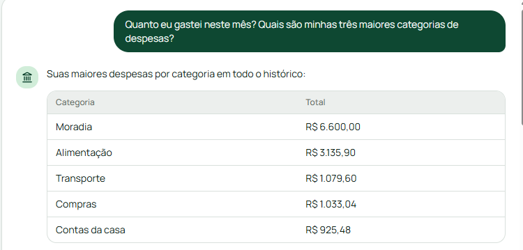
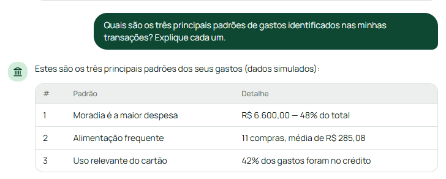
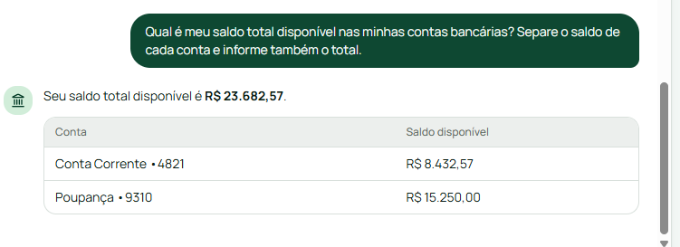

# 💰 Assistente Financeiro Inteligente com MCP

## 📌 Sobre o Projeto

Projeto desenvolvido para o desafio da DIO, com o objetivo de criar um assistente financeiro conversacional capaz de responder perguntas sobre contas bancárias, saldos, cartões, transações e padrões de consumo.

O aplicativo apresenta informações financeiras em linguagem simples e acessível, utilizando dados fictícios para demonstração.

## 🎯 Objetivo

Levar informações financeiras ao cliente por meio de uma interface de chat, facilitando a consulta e a compreensão de suas movimentações.

## 🚀 Funcionalidades

- Consulta de saldos de contas.
- Consulta de despesas por categoria.
- Histórico de transações.
- Identificação de padrões de consumo.
- Análise de gastos.
- Respostas em português.
- Apresentação de informações em tabelas.

## 🛠️ Tecnologias utilizadas

- **Lovable:** criação e publicação da interface web.
- **GitHub:** armazenamento do código e documentação.
- **ChatGPT:** apoio no planejamento e desenvolvimento.
- **Pluggy:** documentação da integração MCP.
- **Plaid:** plataforma prevista para integração com dados fictícios no Sandbox.

## 🔌 Integrações MCP

### Pluggy

Integração planejada com o servidor MCP da Pluggy, plataforma de Open Finance.

- Servidor: https://mcp.pluggy.ai/mcp
- Documentação: https://docs.pluggy.ai/

### Plaid

Integração planejada com o ambiente Sandbox da Plaid para testes com contas, saldos e transações fictícias.

- Painel: https://dashboard.plaid.com/
- Documentação: https://plaid.com/docs/

**Status:** as integrações externas ainda não estão conectadas nesta versão demonstrativa.

## 🔒 Segurança

- Utilização de dados fictícios.
- Não utilização de dados bancários pessoais.
- Não publicar chaves, tokens ou senhas.
- Credenciais de integração devem permanecer protegidas no servidor.

## 🌐 Aplicativo publicado

Acesse o Assistente Financeiro Inteligente:

https://pixel-perfect-echo-597.lovable.app/

## 📸 Evidências do Projeto

### 1. Análise de despesas por categoria

### 2. Identificação dos padrões de gastos

### 3. Consulta de saldo das contas

## 👩‍💻 Desenvolvimento

Projeto desenvolvido para fins educacionais e de portfólio no desafio da DIO.

Os dados apresentados na versão demonstrativa são fictícios e não representam contas bancárias reais.
